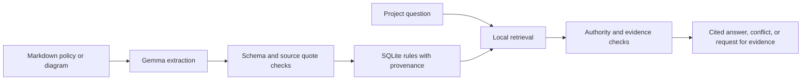

# LORE Lite

LORE Lite helps a developer or coding agent check project rules before acting. It reads Markdown policies and architecture diagrams, extracts candidate rules with Gemma 4, checks each citation against the original text or image transcript, then uses ordinary application code to resolve authority and evidence requirements. Each answer includes its sources and a plain explanation.

**Gemma proposes. Deterministic code decides.** Gemma extracts structured rules and transcribes image content. Python validates the model output and source quotes. The application assigns authority from trusted metadata, retrieves relevant rules, compares conflicts, checks required evidence, and chooses the final state. Asking a question uses the local SQLite database and does not call Gemini.

## How a question is evaluated



The [architecture diagram](demo/architecture.png) shows the product's example database gateway and parameterized query policy.

## Requirements

- Python 3.11 or later
- [`uv`](https://docs.astral.sh/uv/) for environment and command management
- A Gemini API key for first-time extraction. The key is only needed when ingesting a source that is not already stored or cached.

## Install and configure

Run these commands from the repository root:

```bash
uv sync --extra dev
cp .env.example .env
```

Open `.env` in a text editor and set `GEMINI_API_KEY` to your key. Keep `.env` private; git ignores it. Do not paste the key into source files or commit it.

Optional settings:

| Variable | Default | Purpose |
| --- | --- | --- |
| `GEMINI_API_KEY` | unset | Authenticates text and image extraction through Google's Gemini API. |
| `GEMMA_MODEL` | `gemma-4-26b-a4b-it` | Selects the Gemma model ID used by the extractor. |
| `GEMMA_API_TIMEOUT_MS` | `90000` | Maximum wait for one model request, in milliseconds. A timeout means the source was not saved. A longer timeout cannot fix an API or network stall. |

## Run the web app

From the repository root, start Streamlit:

```bash
uv run streamlit run app.py
```

Streamlit prints a local address, usually `http://localhost:8501`. Open it in a browser. The sidebar shows the active SQLite database and provides the source upload controls. Select multiple Markdown files and images in **Add a source** to ingest them as a batch; choose an authority override for images, while Markdown can use its own frontmatter. Each file reports its own success or failure. **Reset workspace data** clears sources, rules, evidence, saved decisions, and the current review state in the selected database after a confirmation step. The app defaults to `demo/lore-demo-final.db` when that file exists; otherwise it creates or uses `lore.db` in the repository root. You can change the database path in the sidebar.

### Try the preloaded demo

The repository contains source files under `demo/`, but local SQLite databases are intentionally excluded from git. On a fresh clone, create a demo database by ingesting the Markdown sources:

```bash
uv run lore ingest demo/security.md --db demo/lore-demo-final.db --config lore.config.yaml
uv run lore ingest demo/backend-wiki.md --db demo/lore-demo-final.db --config lore.config.yaml
uv run lore ingest demo/vendor-note.md --db demo/lore-demo-final.db --config lore.config.yaml
uv run lore ingest demo/session-timeout-policy-a.md --db demo/lore-demo-final.db --config lore.config.yaml
uv run lore ingest demo/session-timeout-policy-b.md --db demo/lore-demo-final.db --config lore.config.yaml
```

Each first-time ingest calls Gemma and needs a working API key and network connection. To add the diagram as an image source, run this separately:

```bash
uv run lore ingest demo/architecture.png --authority approved_policy --db demo/lore-demo-final.db --config lore.config.yaml
```

Image transcription can take longer than text extraction. If Gemini times out and Tesseract OCR is installed, LORE Lite falls back to local text recognition, then continues rule extraction. Install Tesseract (`sudo apt install tesseract-ocr` on Debian or Ubuntu) to enable this fallback. Local OCR may miss diagram arrows and relationships, so the app labels OCR-derived citations and they should be reviewed. If Gemini and local OCR both fail, the image source is not saved.

In the app, try the preset questions:

1. **Can I use raw SQL for the reporting query?** The approved policy outranks the older wiki note. The result cites the policy and explains the override.
2. **Can we use CloudBox for sensitive customer data?** The app asks for the vendor assessment and data residency proof before it can support approval.
3. **What logging format do we use?** The demo corpus has no applicable rule, so LORE Lite reports that it does not know.
4. **What is the session timeout requirement?** Two approved policies disagree at equal rank, so the app asks a person to resolve the conflict.

## Use the command line

The same local database and rules can be inspected without opening the web app:

```bash
uv run lore ask "Can I use raw SQL for the reporting query?" --db demo/lore-demo-final.db --config lore.config.yaml
uv run lore ask "Can we use CloudBox for sensitive customer data?" --db demo/lore-demo-final.db --config lore.config.yaml
uv run lore rules --component database --db demo/lore-demo-final.db
uv run lore conflicts --db demo/lore-demo-final.db
```

`lore ask` returns a JSON result envelope. The Streamlit app translates the result state into a plain-language explanation and keeps the machine-readable envelope available under technical details.

## What the result means

| Result | In everyday language |
| --- | --- |
| `supported` | The sources agree and the required evidence is present. LORE Lite cites the rules it used. |
| `qualified` | A rule applies, but a lower-authority source disagrees or needs to be disclosed. The app explains which source takes priority. |
| `insufficient` | A required document or evidence item is missing. The app lists what a person needs to provide. |
| `conflicting` | Equally trusted sources disagree and the available metadata cannot settle the disagreement. A person must decide. |
| `no_knowledge` | The database has no applicable rule. LORE Lite does not invent one. |

## Cache, citations, and failure handling

- Successful extraction responses and image transcripts are cached under `.cache/gemma/` by input hash. A cache hit is reported as `cached`; it is a replay of a saved model response, not a new model call.
- Text extraction output distinguishes verified rules, rejected rules, and quarantined sections. A fabricated or mismatched source quote is rejected rather than stored.
- Image-derived rules identify their transcription method. Normally, quotes are checked against Gemini's image transcript. If Gemini times out and Tesseract is installed, LORE uses local OCR instead and labels the result `image-ocr`; review diagrams carefully because local OCR may miss arrows and relationships.
- FTS5 is used when SQLite provides it. Retrieval falls back to case-insensitive keyword matching when FTS5 is unavailable.
- Transient Gemini errors can prevent a new source from being ingested. A failed call does not create a source record. Existing local rules can still be queried without the API.

## Tests

Run the unit and end-to-end suite with:

```bash
uv run pytest -q
```

The tests mock Gemma for repeatable coverage of quote checking, schema handling, governance states, evidence requirements, storage, and the sample question flow. They do not guarantee that a live Gemini request or image transcription will respond successfully.

## Known limits

- This is a local hackathon prototype. It has no user authentication, team permissions, hosted database, or production audit controls.
- Retrieval and question classification use a small set of deterministic rules and keywords. They may miss relevant wording in larger or unfamiliar corpora.
- Gemma can return incorrect or incomplete extractions. Quote checks catch unsupported citations, but people still need to review extracted rules and source authority.
- A conflict resolved by the configured authority ladder is a product policy choice, not a legal or security approval. Unresolved conflicts and missing evidence should go to a responsible human.
- Gemini availability, request limits, and response time affect first-time extraction. The successful text demo and prior image acceptance run are recorded in `tasklist.md`; a later retry of the expanded-corpus image ingest timed out.

## Stack and licenses

The application is Python, Streamlit, SQLite, Pydantic, Typer, and PyYAML. This repository uses the MIT License in [`LICENSE`](LICENSE). Gemma 4's model card lists Apache 2.0. The Google Gen AI Python SDK and Streamlit use Apache 2.0; Pydantic and Typer use MIT; PyYAML uses the MIT License. Other transitive packages have their own licenses. Review the specific package notices before redistributing a packaged build.

- [Gemma 4 model card and license](https://ai.google.dev/gemma/docs/core/model_card_4)
- [Google Gen AI Python SDK license](https://github.com/googleapis/python-genai/blob/main/LICENSE)
- [Streamlit license](https://github.com/streamlit/streamlit/blob/develop/LICENSE)
- [Pydantic license](https://github.com/pydantic/pydantic/blob/main/LICENSE)
- [Typer license](https://github.com/fastapi/typer/blob/master/LICENSE)
- [PyYAML license](https://github.com/yaml/pyyaml/blob/main/LICENSE)

## Project files

- `app.py`: Streamlit review console
- `src/lore_lite/`: extraction, verification, storage, retrieval, governance, and CLI
- `lore.config.yaml`: authority levels and required evidence
- `demo/`: sample policies, intentional disagreements, and architecture diagram
- `skill/lore-lite/SKILL.md`: instructions for an agent using LORE Lite
- `tests/`: automated checks
